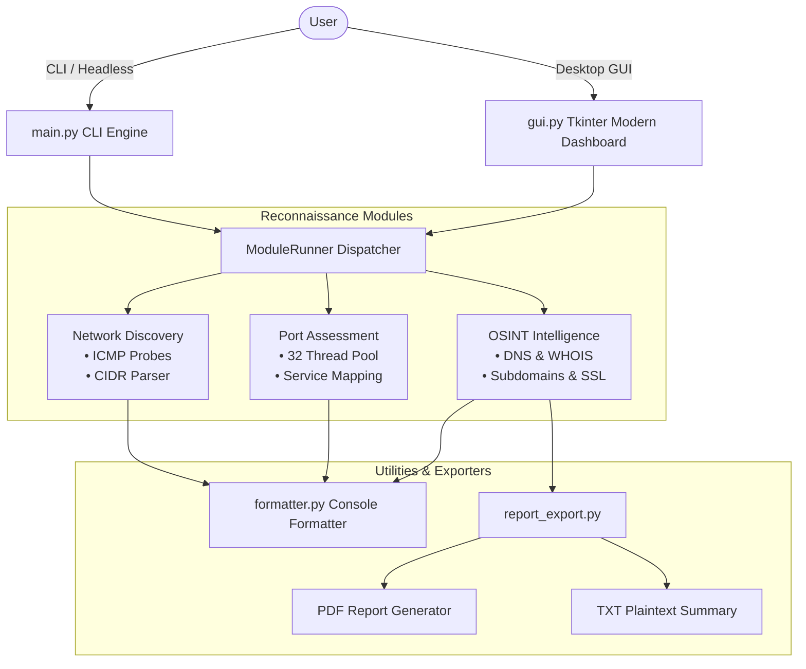

<p align="center">
  
</p>

<p align="center">
  <a href="#-key-features"></a>
  <a href="https://www.python.org/"></a>
  <a href="#-gui-dashboard"></a>
  <a href="#-testing"></a>
  <a href="#-license"></a>
</p>

---

## ⚡ Overview

**BlackBox** is an advanced, high-performance network reconnaissance and security assessment suite crafted for ethical hackers, penetration testers, and system administrators. 

Featuring both a high-speed **Terminal Command-Line Interface (CLI)** and a sleek, multi-threaded **Cyber Dark Graphical User Interface (GUI)**, BlackBox delivers rapid subnet discovery, parallel multi-port auditing, and deep automated OSINT intelligence gathering with zero external GUI bloat.

---

## 📺 Live Terminal & GUI Demo

<p align="center">
  
</p>

---

## 🎯 Key Features

<table>
  <tr>
    <td width="50%">
      <h3>🌐 Network Discovery</h3>
      <ul>
        <li><b>Single Host & Subnet CIDR Scanning</b> (e.g. <code>192.168.1.0/24</code>)</li>
        <li>Native high-speed ICMP echo probes via platform-optimized binaries</li>
        <li>Automatic reverse hostname and NetBIOS resolution</li>
        <li>Real-time live status and latency reporting</li>
      </ul>
    </td>
    <td width="50%">
      <h3>🔌 Parallel Port Assessment</h3>
      <ul>
        <li>Multi-threaded TCP port scanner (up to <b>32 concurrent workers</b>)</li>
        <li>Quick presets for <b>Top 20 Common</b>, <b>Web</b>, <b>Database</b>, and <b>Remote Access</b></li>
        <li>Identifies service signatures and common open protocol banners</li>
        <li>MAC address and NIC vendor detection when available</li>
      </ul>
    </td>
  </tr>
  <tr>
    <td width="50%">
      <h3>🔍 Deep Automated OSINT</h3>
      <ul>
        <li>Domain RDAP / WHOIS registrar & expiration auditing</li>
        <li>Comprehensive DNS records enumeration (<code>A</code>, <code>AAAA</code>, <code>MX</code>, <code>NS</code>, <code>TXT</code>)</li>
        <li>Live active subdomain brute-force discovery</li>
        <li>Web server inspection, HTTP security headers & tech stack detection</li>
        <li>SSL/TLS certificate chain analysis & validity checking</li>
      </ul>
    </td>
    <td width="50%">
      <h3>🖥️ Modern Custom GUI</h3>
      <ul>
        <li><b>Cyber Dark Mode</b> with high-contrast glowing neon aesthetic</li>
        <li>Multi-threaded async execution — zero window freezes or locks</li>
        <li>Interactive tabular views with double-click cross-module transfers</li>
        <li>One-click export to formatted <b>PDF</b> and structured <b>TXT</b> reports</li>
      </ul>
    </td>
  </tr>
</table>

---

## 🖥️ Desktop GUI Dashboard

The custom GUI is designed with an obsidian-cyber dark theme, providing intuitive tabbed navigation:

```text
┌────────────────────────────────────────────────────────────────────────┐
│  ⚡ BLACKBOX PRO  Advanced Reconnaissance & Security Framework  ● IDLE   │
├────────────────────────────────────────────────────────────────────────┤
│  [ 🌐 Network Discovery ] [ 🔌 Port Scanner ] [ 🔍 OSINT ] [ 📄 Logs ] │
├────────────────────────────────────────────────────────────────────────┤
│  Target IP/CIDR: [ 192.168.1.0/24         ] [ ▶ Start ] [ ⏹ Stop ]     │
│                                                                        │
│  IP Address       Status     Hostname / NetBIOS       Response         │
│  ───────────────  ─────────  ───────────────────────  ────────         │
│  192.168.1.1      🟢 ONLINE  router.local (Gateway)   Active           │
│  192.168.1.15     🟢 ONLINE  workstation-pc.lan       Active           │
│  192.168.1.42     🟢 ONLINE  nas-storage.lan          Active           │
│                                                                        │
│  (💡 Tip: Double-click any discovered host to instantly scan its ports!)│
└────────────────────────────────────────────────────────────────────────┘
```

---

## 🚀 Quick Start

### 1. Installation

Clone or download this repository, then install requirements:

```bash
# Clone the repository
git clone https://github.com/RanithuDewage/BlackBox.git
cd BlackBox

# Install requirements
pip install -r requirements.txt
```

### 2. Launch GUI (Desktop Interface)

You can launch the custom graphical interface directly:

```bash
python gui.py
```

*Or via main entrypoint:*

```bash
python main.py --gui
```

### 3. Launch Interactive Terminal Mode

Start BlackBox in interactive CLI mode:

```bash
python main.py
```

The interactive menu will display:
```text
┌──────────────────────────────────────────────────────┐
│                      MAIN MENU                       │
├──────────────────────────────────────────────────────┤
│                                                      │
│   [1]  Discover Network                              │
│   [2]  Scan Ports                                    │
│   [3]  OSINT                                         │
│   [4]  Launch Graphical UI (GUI)                     │
│   [5]  Exit                                          │
│                                                      │
└──────────────────────────────────────────────────────┘
```

### 4. Direct Command-Line (Headless / Automation)

BlackBox also supports direct headless CLI execution:

```bash
# Subnet scan
python main.py --target 192.168.1.0/24 --module network

# Single host port scan
python main.py --target 192.168.1.15 --module ports

# Domain OSINT gathering
python main.py --target example.com --module osint

# List loaded reconnaissance modules
python main.py --list-modules
```

---

## 🏗️ Project Architecture



---

## 📁 Project Structure

```text
BlackBox/
├── assets/
│   ├── header-banner.svg     # Animated cyber header banner
│   └── terminal-demo.svg     # Animated terminal CLI/GUI simulation
├── config/
│   ├── settings.py           # Centralized configuration & branding
│   └── __init__.py
├── modules/
│   ├── core/
│   │   ├── base.py           # Base module class
│   │   ├── registry.py       # Auto module registration
│   │   └── runner.py         # Multi-module orchestrator
│   └── reconnaissance/
│       ├── network.py        # CIDR & host ping discovery
│       ├── ports.py          # Parallel TCP socket scanner
│       └── osint.py          # Domain, DNS, WHOIS, SSL intelligence
├── utils/
│   ├── errors.py             # Custom exceptions
│   ├── formatter.py          # Clean CLI tables & reports
│   ├── logger.py             # Rotating file & console logger
│   ├── report_export.py      # PDF & TXT report generators
│   ├── spinner.py            # Terminal spinner & animations
│   └── validators.py         # IP, CIDR & domain validators
├── tests/                    # Unit & regression test suite
├── gui.py                    # Sleek Cyber Dark Graphical Interface
├── main.py                   # CLI entrypoint & interactive menu
├── pyproject.toml            # Project packaging specification
├── requirements.txt          # Python dependencies
└── README.md                 # Documentation
```

---

## 🛠️ Customizing Project Names & Branding

You can easily rebrand this framework to your own custom name, handle, or organization! Simply edit [`config/settings.py`](file:///d:/BlackBox-main/BlackBox-main/config/settings.py):

```python
# config/settings.py

APP_NAME = "MyToolName"       # Update to your tool name (e.g. CyberRecon)
VERSION = "2.0.0"
AUTHOR = "Your Name / Handle"  # Update to your name
GITHUB_URL = "https://github.com/your-username/MyToolName"
```

All CLI banners, reports, logs, GUI windows, and User-Agents automatically update instantly!

---

## 📦 Setting Up Git & Pushing to GitHub

Since you haven't linked a Git folder yet, here are the step-by-step instructions to push this project to GitHub or GitLab:

### Step 1: Initialize Git Repository Locally
Open PowerShell or your terminal in this directory:
```bash
git init
git add .
git commit -m "Initial commit: Rebranded BlackBox v2.0 with custom Modern GUI and animated README"
```

### Step 2: Create a New Repository on GitHub
1. Go to [github.com/new](https://github.com/new).
2. Choose a repository name (e.g., `BlackBox` or your custom project name).
3. Leave "Initialize with README" **unchecked** (since we already built a great README).
4. Click **Create repository**.

### Step 3: Link Remote & Push
Copy your repository URL from GitHub and run:
```bash
# Rename branch to main
git branch -M main

# Add your GitHub remote repository
git remote add origin https://github.com/RanithuDewage/BlackBox.git

# Push code to GitHub
git push -u origin main
```

---

## 🛡️ Responsible Disclosure & Legal Disclaimer

> [!WARNING]
> This software is designed exclusively for authorized educational research, authorized network diagnostics, and penetration testing on systems you own or have explicit, documented permission to test. Unauthorized scanning or probing of external networks is illegal under applicable cybercrime legislation. The author accepts no liability for misuse.

---

## 📄 License

Distributed under the **MIT License**. See `LICENSE` for more information.
